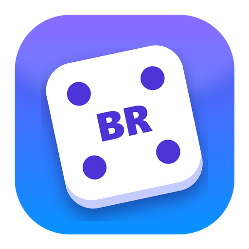

<p align="center"></p>

# Backlog Roulette 2.2

Рандомайзер «Во что сыграть дальше?» для вашей библиотеки Steam в стиле Windows 11.
Крутите барабан с обложками: он плавно останавливается на случайной игре. Пройденные игры убираются из списка одной кнопкой.

> До версии 2.0.6 программа называлась **My Steam Random**.

## Возможности

- **Барабан с обложками**: лента быстро прокручивается и плавно тормозит, одна игра не выпадает два раза подряд.
- **Стиль Windows 11**: светлая и тёмная тема, плавные переходы между вкладками, всплывающие уведомления.
- **Музыкальный плеер**: встроенная тема, своя папка или трек и **скачанные саундтреки Steam**. Кроссфейд между треками, «вперемешку», повтор трека, мини-плеер на каждой странице.
- **Страница игры** после каждого прокрута: трейлер в 1080p, скриншоты, описание на русском, оценки, отзывы игроков, обзоры, достижения и саундтрек игры.
- **Встроенный браузер** для ссылок со страницы игры.
- **Кнопка «Играть»**: запуск или установка выпавшей игры в Steam одним кликом.
- **Импорт из Steam с учётом ваших коллекций**: отметьте коллекции, из которых брать игры, скрытые игры пропускаются. Учитываются и игры семейной библиотеки Steam, если они лежат в ваших коллекциях. Сторонние (не Steam) игры из коллекций не попадают.
- **Обложки скачиваются сами**: при первом запуске — экран с прогрессом, потом барабан. Сначала официальная обложка Steam, если её нет — из SteamGridDB. Можно поставить и свою.
- **Вкладка «Игры»**: поиск, ручное добавление (по одной в строке или через `|`), удаление нескольких игр сразу, полная очистка списка.
- Старый список из `SteamGames.xlsx` переносится автоматически при первом запуске.

## Что нового в 2.2

- **Вкладка «Саундтреки»** — плеер для саундтреков Steam, работает и без запущенного Steam:
  - слева — саундтреки, скачанные на этот ПК, с обложками, и купленные, но не скачанные;
  - справа — треки выбранного альбома; двойной клик — слушать с этого трека, играющий трек выделен. За треками играющего альбома — его размытая обложка, плавно переходящая в список альбомов;
  - внизу — обложка, название трека и альбома, «предыдущий» / пауза / «следующий», перемотка со временем, громкость, «вперемешку» и «повтор трека».
  - **«Вперемешку»** — значок в плеере и в мини-плеере, переключается по кругу: выключено → вся музыка (скачанные саундтреки и своя музыка из «Настроек», без встроенной темы) → только скачанные саундтреки.
  - **«Повтор трека»** — тоже значок (петля, с единицей — когда включён), в плеере и в мини-плеере.
  - Встроенная тема и своя папка или трек остались в «Настройках» → «Звук».
- **Звук не пропадает**, когда Windows меняет звуковые устройства (например, Steam при выходе убирает свои виртуальные колонки, отключили наушники): музыка сама переходит на устройство по умолчанию.
- **Саундтреки Steam.** Программа сама находит скачанные саундтреки во всех папках библиотек Steam (`steamapps\music`). Названия треков показываются без длинного общего начала вроде «The Medium Original Soundtrack - ». Если альбом лежит сразу в MP3 и FLAC, каждый трек берётся один раз. К какой игре относится альбом, программа узнаёт у магазина Steam и запоминает в `steam_soundtracks.json`.
- **Обложки альбомов** — квадратные, как в библиотеке Steam: из папки альбома, из кэша клиента Steam или вшитые в сами треки. Шапка страницы магазина — только если обложки нигде нет.
- **«Синхронизировать со Steam»** на вкладке «Саундтреки» показывает и купленные, но не скачанные саундтреки. Двойной клик — Steam откроет окно скачивания, а скачанный альбом сам появится в списке. Список покупок Steam отдаёт только после входа в магазин, поэтому в первый раз программа попросит войти во встроенном браузере. Пароль вводится на сайте Steam, программа его не видит; вход хранится в `cache\web`.
- **Саундтрек на странице игры:** «Слушать саундтрек», если он скачан, или «Скачать саундтрек», если куплен, но не скачан.
- **Мини-плеер** на рулетке, странице игры и во встроенном браузере: нота — перейти на вкладку «Саундтреки» к тому, что играет, выключить звук, предыдущий трек, пауза, следующий трек, «вперемешку», «повтор трека». Название трека — во всплывающей подсказке.
- Во встроенном браузере «Во внешнем браузере» теперь стоит сразу после «К карточке».
- **«О программе» — отдельный пункт меню** под «Настройками»: версия, автор, лицензия, ссылки на проект и на страницу ошибок. Боковое меню стало чуть шире, чтобы подписи не обрезались.
- **Трейлер переключается на 1080p без заминки**: второй проигрыватель заранее открывает 1080p чуть впереди и подменяет обычное качество ровно в тот момент, когда трейлер туда доходит.
- **Быстрый старт трейлеров**: у новых трейлеров Steam нет обычных mp4, и раньше приходилось ждать, пока соберётся весь 1080p (10 секунд и дольше). Теперь сначала за пару секунд качается лёгкий вариант того же потока — трейлер начинается им, а 1080p подменяет его без паузы, когда докачается.
- **Живые фоны** в шапке страницы игры: страница всегда открывается с обычным фоном, а программа в фоне только проверяет, есть ли у игры анимированный фон в SteamGridDB (Heroes → Animated). Если есть, в левом верхнем углу шапки появляется значок. Первое нажатие качает живой фон — по краю значка бежит кольцо загрузки — и включает его, следующие переключают шапку между живым и обычным фоном. Нет живого фона — нет и значка. Нужен ключ SteamGridDB; скачанные хранятся в `cache\hero`. Пока идёт трейлер или страница игры не видна, живой фон стоит на паузе.
- **Описание игры больше не ждёт переводчик**: страница сразу показывает описание из Steam как есть, а перевод на русский подставляется, когда придёт.
- **Встроенный браузер открывается без мигания окна**: его движок загружается при запуске программы, а не при первой ссылке.
- **Исправлена светлая тема**: с встроенным браузером меню и фон окна становились чёрными. Теперь окно рисует сплошной фон своей темы вместо полупрозрачного Mica (Mica остаётся, только если PySide6 собран без браузера).
- **Замеры скорости в логе** — строки «Замер: …»: запуск по этапам, открытие карточки игры (когда она на экране и когда пришли фон и описание), переключение вкладок, загрузка страницы во встроенном браузере, поиск саундтреков. По ним видно, что стоит ускорять.
- **Апострофы в названиях**: Steam присылал некоторые названия с HTML-кодами — «Assassin&amp;apos;s Creed». Теперь они раскрываются, а уже сохранённые названия и их обложки исправляются при запуске.
- **Достижения в играх из семейной библиотеки**: Steam Web API не отдаёт по ним ваш прогресс, поэтому программа берёт его со страницы достижений вашего профиля. Если не вышло и там, на карточке написано почему: например, закрыта «Игровая информация» в приватности профиля.

## Что нового в 2.1

- **Страница игры.** Барабан остановился, и через секунду вместо рулетки открывается страница выпавшей игры — во всю рабочую область окна:
  - шапка во всю ширину с фоном игры и её логотипом — из Steam, а если там нет, то из SteamGridDB; без них — размытая обложка; высота шапки растёт вместе с окном;
  - под всей страницей — тот же фон, сильно размытый, поэтому в большом окне нет пустых мест;
  - кнопки по центру: «Играть» / «Установить», «Крутить ещё», «Пройдена», «Своя обложка», «Магазин Steam» и «К рулетке»;
  - скриншоты из магазина Steam с лентой превью;
  - под скриншотами — **плашки** с жанрами, датой выхода, разработчиком, числом достижений, **оценкой игроков Steam**, Metacritic и **обзорами** StopGame, Игромании и Zone of Games; плашки со ссылкой нажимаются;
  - краткое и **полное описание со страницы Steam**; если русского текста нет, он переводится автоматически (через Google Переводчик), названия и разработчики остаются как в Steam;
  - **«Что пишут игроки»** — самые полезные отзывы из Steam на русском (обновляются раз в сутки, кэш — `steam_reviews.json`);
  - **достижения** под спойлером: сколько получено, значки, описания, у какой доли игроков они есть. Нужен ключ Steam Web API; ваш прогресс виден, если игра на вашем аккаунте и игровая информация профиля открыта.
  - Всё стоит по центру и подстраивается под размер окна: кнопки и плашки переносятся на новую строку, достижения раскладываются в 1–3 колонки.
- **Трейлеры в 1080p.** Кнопка ▶ по центру шапки открывает трейлер поверх всего окна, кнопки плеера лежат поверх видео и прячутся, если не двигать мышь. Esc — закрыть, пробел — пауза, ← → — на 5 секунд; музыка программы на это время плавно затихает.
  - Трейлер начинается сразу, в обычном качестве, а 1080p тем временем качается в фоне. Как только он готов, видео переключается на него с того же места.
  - Новые трейлеры Steam отдаёт только потоком, который проигрыватель Qt не открывает, поэтому программа сама собирает его в обычный mp4. Последние 6 трейлеров хранятся в `cache\trailers` и второй раз сразу открываются в 1080p.
  - Если смотреть пока нечего, вместо чёрного экрана — размытая картинка игры и полоса загрузки.
- **Встроенный браузер.** Ссылки с плашек (Metacritic, отзывы, обзоры) можно открыть прямо в программе — на весь экран, с кнопкой «К карточке», «назад» / «вперёд» и «Во внешнем браузере». Программа спрашивает, где открыть; с галочкой «Больше не спрашивать» запоминает выбор. Поменять его можно в «Настройках» → «Ссылки». Куки и кэш сайтов — в `cache\web`.
- **Фон рулетки — «фотоплёнка» из ваших обложек**: наклонные ленты медленно едут навстречу друг другу, фон размыт, чтобы барабан читался чётко.
- **Барабан крупнее**: обложки 240×360. В узком окне, где видно всего три обложки, боковые притушены — как дальние в широком окне.
- **На рулетке осталась одна кнопка — «Крутить».** Всё остальное переехало на страницу игры. Кнопки музыки теперь лежат поверх фона в правом верхнем углу.
- **«О программе»** в «Настройках»: версия, автор, лицензия, ссылки на проект и на страницу ошибок. Автор и версия видны и в свойствах `BacklogRoulette.exe`.
- В списке игр пункт меню «Открыть страницу игры» вместо «Показать на рулетке».
- Описания хранятся в `steam_details.json` (обновляются раз в две недели, непереведённые — через час), фоны и логотипы — в папке `cache\`, поэтому повторно страница открывается сразу.
- **Логи больше не стираются**: кнопка «Начать заново» на вкладке «Логи» переносит текущий журнал в `logs\app.log.1`.
- **Сторож зависаний**: если окно перестанет отвечать дольше 15 секунд, программа запишет в `logs\hang.log`, где именно она застряла. Эти записи видны внизу вкладки «Логи».
- Исправлено: отзывы Steam перестали загружаться после того, как 22 октября 2026 Steam отключил старый адрес отзывов. Программа перешла на новый.

> Встроенный браузер и FFmpeg для трейлеров входят в PySide6. Из-за браузера `BacklogRoulette.exe` стал заметно больше.

## Что нового в 2.0.6

- **Новое название — Backlog Roulette.** Старое было слишком привязано к слову «Steam», а Valve не разрешает использовать его в названиях сторонних программ. Программа по-прежнему работает с библиотекой Steam.
- **Новый значок**: игральный кубик с буквами **BR** вместо центральной точки на фиолетово-синем фоне. Значок рисует скрипт `make_icon.py`, поэтому его легко перекрасить.
- Значок теперь показывается и на панели задач Windows, и во всех окнах программы, даже при запуске из `.py`.
- Файл программы теперь называется `BacklogRoulette.exe`. Список игр, обложки и настройки остаются на месте: положите новый `.exe` в ту же папку, а старый `MySteamRandomApp.exe` удалите.

## Что нового в 2.0.5

- **Кнопка «Играть»** на рулетке запускает выпавшую игру прямо в Steam. Если игра не установлена, кнопка называется «Установить» и открывает окно установки Steam. Программа сама проверяет все папки библиотек Steam на всех дисках. Для игр, добавленных вручную без Steam ID, кнопка неактивна.
- **Звуки барабана**: щелчок на каждой карточке во время прокрутки и мелодичный звук при остановке. Звуки синтезируются прямо в программе, без сторонних файлов. Отключаются в настройках.
- **Быстрая синхронизация**: кнопка «Синхронизировать» на вкладке «Игры» повторяет импорт из Steam с прошлым выбором коллекций, без окна настроек. Становится доступна после первого импорта через «Импорт из Steam». Если выбранные коллекции пропали из Steam, программа предупредит и не станет импортировать всю библиотеку.
- **Своя музыка**: в настройках можно выбрать любой трек на ПК (mp3, wav, ogg, flac, m4a и др.) или **целую папку** — тогда треки из неё и подпапок перемешиваются при каждом запуске и играют по очереди, а рядом с кнопкой музыки на рулетке появляется «Следующий трек». Кнопка «Встроенная» возвращает трек по умолчанию.
- **Меню по правой кнопке в списке игр**: «Играть» / «Установить», «Открыть в магазине Steam», «Показать на рулетке», «Удалить из списка». Двойной клик по игре — запуск.
- **Окно ожидания Steam**: при запуске, установке или открытии магазина появляется окно с полосой прогресса, чтобы было видно, что программа не зависла. Оно само закрывается, как только команда передана в Steam, игра запустилась или окно Steam вышло на передний план. Если Steam не запущен, окно предупреждает, что запуск займёт 20–40 секунд. Команда Steam отправляется в фоне и не подвешивает окно программы.
- **Плейлист из папки с кроссфейдом**: за 4 секунды до конца трека следующий начинает звучать поверх него — один плавно затихает, другой плавно нарастает, без пауз между песнями. Если трек короткий или Windows неточно определила его длину, следующий всё равно включится сам.
- **Импорт с семейной библиотекой стал быстрее**: названия семейных игр запоминаются в `steam_app_names.json`, и со второго раза импорт занимает секунды. Раз в неделю кэш обновляется. Пока идёт загрузка, открыто окно с полосой прогресса и описанием текущего шага; его можно скрыть, загрузка продолжится.
- Окно импорта запоминает и галочку «Только игры, в которые я ещё не играл».
- **Вкладка «Логи»**: журнал работы программы и всех ошибок (файл `logs\app.log`). Кнопки «Копировать всё», «Открыть папку», «Очистить». Ключи API в логах автоматически заменяются на `***`. Любая непредвиденная ошибка теперь показывается уведомлением, а не проходит молча.
- Исправлено: импорт из Steam падал с ошибкой при каждом запуске.
- Вкладка «Настройки» прокручивается, если не помещается в окно.

## Что нового в 2.0

Версия 2.0 — полная переработка программы. Логика и интерфейс написаны заново.

### Интерфейс
- Вместо Tkinter — **PySide6 + PySide6-Fluent-Widgets**: окно в стиле Windows 11 с эффектом Mica, светлой, тёмной и системной темой.
- Три вкладки: **«Рулетка»**, **«Игры»**, **«Настройки»**, с плавными переходами между ними.
- **Барабан с обложками** вместо одной картинки: лента разгоняется и плавно тормозит примерно за 4 секунды, выпавшая игра подсвечивается рамкой, её название плавно появляется.
- **Кнопка «Крутить» работает сколько угодно раз**: раньше программа закрывалась после каждого выбора.
- Всплывающие уведомления вместо стандартных окон Windows.

### Импорт из Steam
- **Импорт всей библиотеки** через Steam Web API вместо ручного добавления каждой игры.
- **Коллекции Steam**: можно брать игры только из выбранных коллекций (например, «Архив»), скрытые игры пропускаются.
- **Семейная библиотека Steam**: игры членов семьи из ваших коллекций тоже импортируются, их названия берутся из списка игр магазина Steam.
- Сторонние игры, добавленные в Steam вручную, отсеиваются автоматически.
- Фильтр «Только игры, в которые я ещё не играл» и режим «Заменить мой список».
- Выбор в окне импорта запоминается до следующего раза.

### Обложки
- Обложки скачиваются автоматически: официальная обложка Steam, а если её нет — из SteamGridDB.
- **Экран загрузки с прогрессом** при первом запуске и после большого импорта; скачивание идёт в 4 потока.
- Игры без найденной обложки запоминаются, чтобы не искать их при каждом запуске.
- Кнопка **«Своя обложка»** — поставить любую картинку вручную.

### Список игр
- Список хранится в **`games.json`** вместо `SteamGames.xlsx`, старый файл переносится автоматически.
- Вкладка «Игры»: поиск, добавление нескольких игр сразу, удаление выделенных, **очистка всего списка**.
- Повторы при добавлении пропускаются.

### Музыка
- Фоновая музыка с плавным нарастанием громкости, кнопка вкл/выкл на рулетке, громкость в настройках.

### Исправления и устройство проекта
- Программа больше не привязана к папке `D:\Projects\...`: данные ищутся рядом со скриптом или `.exe`.
- Не падает при пустом или отсутствующем списке игр; повреждённый `games.json` откладывается в сторону, а не перезаписывается.
- Названия игр с `&`, `#`, `?` корректно передаются в поиск обложек; у сетевых запросов есть таймаут, окно не зависает.
- Логика вынесена в `core.py`, интерфейс — в `MySteamRandomApp.py`.
- Ключи хранятся в `api_key.txt` и `settings.json` и не попадают в репозиторий.
- Добавлены `requirements.txt`, `build.bat` для сборки `.exe` и `.gitignore`.

## Установка

Нужен **Python 3.10+**.

```bat
cd D:\Projects\MySteamRandomApp
pip install -r requirements.txt
python MySteamRandomApp.py
```

### Сборка .exe

Запустите `build.bat`. Он поставит зависимости и PyInstaller, нарисует значок (если `icon.ico` ещё нет), соберёт программу и положит `BacklogRoulette.exe` в папку проекта. Значок и музыка вшиваются в `.exe`.

> `.exe` должен лежать в одной папке с `games.json`, `covers\` и `api_key.txt`: программа ищет данные рядом с собой.

## Ключи и настройки

Ключи в репозиторий не входят: после клонирования введите свои на вкладке **«Настройки»**, программа сохранит их в `api_key.txt` и `settings.json`.

| Что | Зачем | Где взять |
| --- | --- | --- |
| SteamGridDB API key | Обложки для игр без Steam ID | steamgriddb.com → Preferences → API |
| Steam Web API key | Импорт библиотеки | steamcommunity.com/dev/apikey |
| SteamID64 | Чью библиотеку импортировать | 17 цифр, например через steamid.io |

Для импорта в настройках приватности профиля Steam раздел **«Игровая информация»** должен быть открыт для всех.

Коллекции берутся из файла `Steam\userdata\<id аккаунта>\config\cloudstorage\cloud-storage-namespace-1.json`. Если вы только что меняли коллекции, перезапустите Steam, чтобы он записал изменения на диск. Динамические коллекции (собранные по фильтрам) Steam на диск не сохраняет, поэтому их в списке нет.

Игры семейной библиотеки Steam по обычному ключу API получить нельзя, поэтому программа находит их по вашим коллекциям: видны те семейные игры, которые лежат хотя бы в одной коллекции (включая «Скрытые»). Время игры в них Steam не сообщает, поэтому для фильтра «ещё не играл» они считаются неначатыми. Поиск названий по списку магазина Steam занимает до минуты.

## Файлы

| Файл | Что внутри |
| --- | --- |
| `MySteamRandomApp.py` | Интерфейс |
| `core.py` | Логика: список игр, обложки, Steam, настройки |
| `apptheme.mp3` | Фоновая музыка |
| `icon.ico`, `icon.png` | Значок программы |
| `make_icon.py` | Рисует значок: `python make_icon.py` |
| `version_info.txt` | Автор и версия в свойствах `.exe` (для сборки) |
| `LICENSE` | Текст лицензии GNU GPL v3 |
| `games.json` | Список игр (создаётся сам) |
| `covers\` | Обложки, имя файла = название игры |
| `cache\` | Фоны, логотипы, трейлеры, картинки саундтреков и данные сайтов встроенного браузера (создаётся сам, не попадает в git) |
| `steam_soundtracks.json` | Какие приложения Steam — саундтреки, к каким играм они относятся и какие куплены (создаётся сам, не попадает в git) |
| `api_key.txt` | Ключ SteamGridDB (не попадает в git) |
| `settings.json` | Ключ Steam, SteamID, музыка, звук, тема, выбор для синхронизации и где открывать ссылки (не попадает в git) |

## Авторы и лицензии

- **Автор программы — Sergey Tsepa ([byRedFox](https://github.com/byRedFox)), © 2026.** Программа свободная и распространяется по лицензии [GNU GPL v3](LICENSE): её можно использовать, изменять и распространять, сохраняя ту же лицензию и указание автора.
- Steam — торговая марка Valve Corporation. Backlog Roulette не связан с Valve и не одобрен ею.
- Музыка `apptheme.mp3` — «Soliloquy», автор [Matthew Pablo](http://www.matthewpablo.com), [OpenGameArt](https://opengameart.org/content/soliloquy), лицензия [CC-BY 3.0](http://creativecommons.org/licenses/by/3.0/). Трек используется без изменений, переименован только файл.
- Интерфейс построен на [PySide6-Fluent-Widgets](https://github.com/zhiyiYo/PyQt-Fluent-Widgets) (GPLv3 для некоммерческих проектов).
